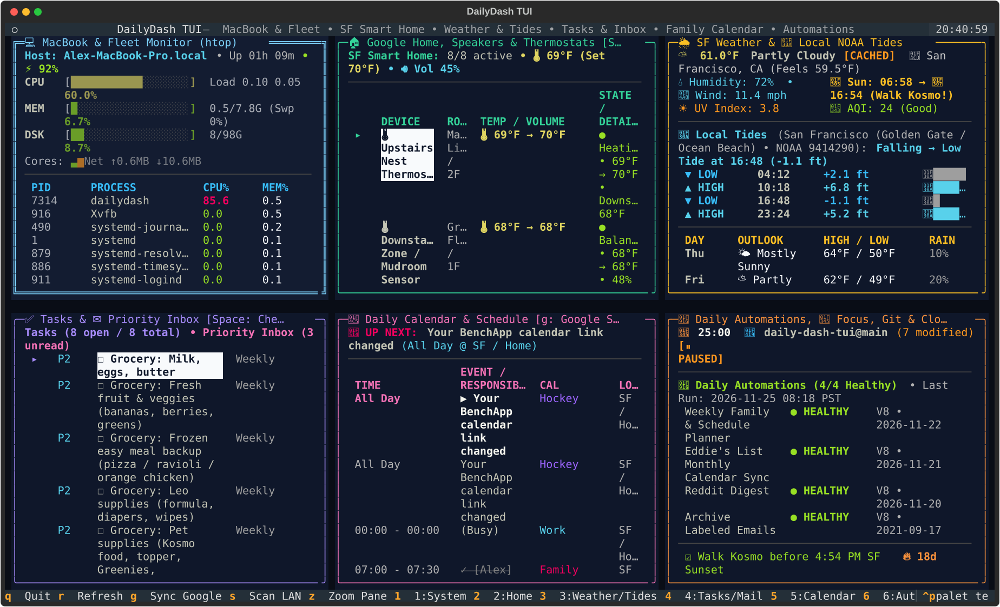

# DailyDash TUI (`dailydash`)

A customizable, multi-pane terminal user interface (TUI) dashboard for your daily life, built with [Textual](https://textual.textualize.io/) and [Rich](https://github.com/Textualize/rich).



## ✨ Key Panes & Features

DailyDash organizes your daily operational & personal life into **6 distinct, keyboard-navigable panes** that dynamically scale to fill 100% of your terminal width and height (including full-screen `z` Zoom mode):

1. **`[1]` 💻 MacBook & Fleet Monitor (Simplified `htop`)**
   - Live CPU, Memory, Disk gauges (with dynamic full-width progress bars), per-core sparklines (up to 24 cores in zoom mode), battery/power status, network I/O counters, and a dynamically sized table of top resource-consuming processes (`psutil`).
   - Quick status strip (or full fleet table when zoomed) for your MacBook and discovered LAN machines (`Alex-MacBook-Pro.local`, `nest-wifi-pro-gateway.local`, `poe-nvr-cameras.local`).
2. **`[2]` 🏠 Google Home, Speakers & Thermostats (Live Volume, Temperatures & LAN Auto-Discovery)**
   - **Live Thermostat Telemetry (`TEMP / VOLUME` column)**: Displays ambient temperature (`°F`), target setpoint (`→ °F`), downstairs sensor reading, relative humidity (`% RH`), and HVAC mode (`Heating` / `Balanced` / `Eco Mode`). Supports live polling via Google Nest SDM API (`GOOGLE_SDM_PROJECT_ID` / `GOOGLE_SDM_ACCESS_TOKEN`), Home Assistant / Matter bridge (`HA_URL` / `HA_TOKEN`), or local thermostat HTTP JSON endpoints.
   - **Live Smart Speaker Volume & Media (`pychromecast`)**: Connects directly to Google Home / Nest Hub Max / Nest Audio speakers over the local Cast protocol (`:8009`) to pull real-time **volume percentage (`0–100%`)**, visual volume bars (`🔊 45% ██░░░`), **mute status**, and currently playing media/radio stream.
   - **Interactive Controls**: Select a speaker or thermostat with `↑`/`↓` (or `j`/`k`) and press **`+` / `-`** (or `←` / `→`) to adjust **Speaker Volume (`±5%`)** or **Thermostat Target Setpoint (`±1°F`)**, or press **`m`** to mute/unmute a Cast speaker on your LAN.
   - **Auto-Discovery (`--scan-network` or press `s` inside the TUI)**: Automatically scans your local LAN via **mDNS/Bonjour**, **ARP neighbor table**, and concurrent TCP probes for **Google Cast / Nest** (`:8008`, `:8009`, `:8443`), **Matter** (`:5540`), and **macOS/SSH hosts** (`:22`, `:548`, `:5900`).
3. **`[3]` 🌦️ SF Weather & 🌊 Local NOAA Tides**
   - Live San Francisco weather powered by Open-Meteo (with automatic offline fallback), feels-like temperature, humidity, wind speed, UV index, AQI, sunrise/sunset times (critical for walking Kosmo before dark!), and a multi-day forecast.
   - **Local NOAA Tides (Station `9414290` — San Francisco / Golden Gate & Ocean Beach)**: Pulls live High/Low tide predictions in MLLW feet from the NOAA CO-OPS API with rising/falling status and visual tide height bars.
4. **`[4]` ✅ Tasks & ✉️ Priority Inbox (Live Google Docs Sync)**
   - Syncs directly with your **Shared Shopping List & Weekly Tasks** Google Doc and **1950s SF Home Maintenance Strategy** checklist (`--sync-google` or press `g` inside the TUI).
   - Interactive completion toggling (`Space` / `x`), paired with an unread Priority Inbox & Apps Script Automation summary.
5. **`[5]` 📅 Daily Calendar & Schedule (Live Google Calendar Sync)**
   - Syncs directly with your Google Calendars (`mjalexja@gmail.com`, `amarchev91@gmail.com`, `marchevskiy@google.com`, and Hockey calendars `Silver Squids` / `Flying Squids`).
   - Shows an **Up-Next** banner plus your daily responsibility timeline (`[Alex]` / `[MJ]` Leo wake-up, daycare drop-off/pick-up at Villa de Kapuso YMCA, Kosmo walks before sunset, dinner, bath & bedtime).
6. **`[6]` 🤖 Daily Automations, 🍅 Focus, Git Pulse, Habits & World Clocks**
   - **🤖 Daily Automations Status**: Live health check parsed directly from your **Google Apps Script Status Log** Google Doc (`Weekly Family & Schedule Planner`, `Eddie's List Monthly Calendar Sync`, `Reddit Digest`, and `Archive Labeled Emails` — runtime V8, timezone, and verified output).
   - **🍅 Pomodoro Focus Timer**: Interactive 25-minute countdown (`p` to start/pause, `r` to reset).
   - **🐙 Git & GitHub Pulse**: Live local repo branch, dirty file counter, and CI status at a glance.
   - **🔥 Daily Habit Streaks**: Track daily habits (walking Kosmo before 4:54 PM sunset, Leo pickup `<8h`, ground-floor humidity 40–55%) with streak counters (`h` to toggle).
   - **🌐 World Clocks**: Full-width 2×2 multi-timezone clock grid (`SF / Sunnyvale`, `Chicago (Bulls/Hawks)`, `New York / EST`, `London (Arsenal FC)`).

---

## 🚀 Copy-Paste Quick Start & Update (CLI)

### Fresh Clone & Install

```bash
git clone https://github.com/marchevskiy/daily-dash-tui.git
cd daily-dash-tui
pip install -e .
dailydash --init-config --scan-network
dailydash
```

### Pull Latest Updates & Launch

```bash
cd daily-dash-tui
git pull origin main
pip install -e .
dailydash --init-config --scan-network
dailydash
```

---

## ⌨️ Keyboard Shortcuts

| Key | Action |
| :--- | :--- |
| `1` – `6` | Jump focus directly to Pane `1` through `6` |
| `Tab` / `Shift+Tab` | Cycle focus across panes |
| `z` | **Full-Screen Zoom / Maximize** focused pane (expands bars, columns, and row counts; press `z` again to restore 3×2 grid) |
| `g` | **Live Google Sync**: Pull today's Google Calendar events, Google Docs tasks, & Apps Script automation statuses |
| `s` | **Live LAN Scan**: Auto-discover Google Home / Cast / Matter devices & hosts on your Wi-Fi |
| `j` / `k` or `↑` / `↓` | Move cursor inside **Google Home** or **Tasks** panes |
| `Space` / `Enter` | Toggle selected Google Home device (Pane 2) or check/uncheck Task (Pane 4) |
| `p` | Start / Pause Pomodoro timer (when Pane 6 is focused) |
| `h` | Toggle next daily habit streak (when Pane 6 is focused) |
| `r` | Refresh all system metrics, weather, and NOAA tides immediately |
| `q` | Quit dashboard |
